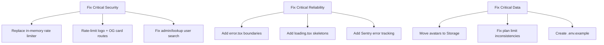

# Vouch Codebase Architecture Audit

**Auditor:** Principal Software Engineer / Software Architect
**Date:** March 8, 2026
**Scope:** Full codebase audit — architecture, security, performance, code quality, scalability, maintainability
**Stack:** Next.js 16 (App Router) · React 19 · TypeScript 5 · Supabase · Lemon Squeezy · Tailwind 4 · shadcn/ui

---

## Executive Summary

Vouch's codebase is **competently architected for a solo-founder SaaS at launch stage**. The developer has made several strong architectural decisions: Supabase SSR cookie handling, timing-safe HMAC webhook verification, tiered Content-Security-Policy headers, font/URL sanitization against CSS injection, and Shadow DOM embed isolation. However, at the current scale, the codebase carries **significant technical debt risks** that will compound as the product grows.

The 5 most critical findings:

> [!CAUTION]
> 1. **Avatar images stored as base64 in the database** — will balloon row size and kill query performance
> 2. **In-memory rate limiter resets on every deployment** — zero protection in serverless/edge
> 3. **6 files exceed 1000 lines each** — untestable monoliths
> 4. **Zero `error.tsx` or `loading.tsx` boundary files** — unhandled crashes show white screens
> 5. **No database migration files or schema versioning** — unrecoverable without Supabase dashboard

---

## Table of Contents

1. [Architecture & Structure](#1-architecture--structure)
2. [Security Audit](#2-security-audit)
3. [Code Quality](#3-code-quality)
4. [Performance](#4-performance)
5. [Scalability & Maintainability](#5-scalability--maintainability)
6. [Testing Coverage](#6-testing-coverage)
7. [Deployment & DevOps](#7-deployment--devops)
8. [Priority Matrix](#8-priority-matrix)

---

## 1. Architecture & Structure

### 1.1 File Organization & Module Boundaries

The project follows Next.js App Router conventions with route groups:

```
src/app/
├── (auth)/          # login, signup, forgot-password
├── (dashboard)/     # main SaaS dashboard
├── (marketing)/     # landing, pricing, features pages
├── admin/           # admin panel
├── api/             # 14 API routes across 5 modules
├── c/               # public collection form
├── embed/           # widget embed page
├── p/               # public page
└── report/          # client report pages
```

**What's good:** Clean route groups, logical separation of public/auth/dashboard surfaces.

**Issues:**

| # | Finding | Severity |
|---|---------|----------|
| A1 | **No shared layout between route groups.** Each group likely re-fetches session info independently. The `(dashboard)` group should have a shared `layout.tsx` that fetches the user session once via a server component and passes it down. | Medium |
| A2 | **Single `ProjectContext.tsx` provides ALL dashboard state.** Projects, subscription plan, and selected project are all in one context. Any update to any value re-renders the entire dashboard tree. | High |
| A3 | **The `src/components/shared/` directory is empty.** This means there are zero shared components despite massive duplication across pages (skeleton loaders, empty states, stat cards are all inlined in page files). | High |
| A4 | **The `src/lib/hooks/` directory is empty.** No custom hooks exist for common patterns like data fetching, debouncing, or subscription checking — all logic is hardcoded per page. | Medium |

### 1.2 Routing Architecture (App Router Patterns)

| # | Finding | Severity |
|---|---------|----------|
| A5 | **Every dashboard page is `'use client'`** — the massive pages (`widgets/page.tsx` at 2108 lines, `inbox/page.tsx` at 1401 lines, `settings/page.tsx` at 1308 lines, `forms/page.tsx` at 1044 lines) are all entirely client-side React components. This means **zero server-side rendering** of the dashboard. All data fetching happens on the client via `useEffect`, causing waterfall requests after hydration. | Critical |
| A6 | **No `loading.tsx` files anywhere in the app.** Next.js App Router uses these to show instant loading UI during navigation. Without them, users see a **white flash** on every route change. | High |
| A7 | **No `error.tsx` files anywhere in the app.** Unhandled runtime errors crash to a blank white screen. There's a `not-found.tsx` but no error boundary. | High |
| A8 | **`robots.ts` and `sitemap.ts` exist** — good for SEO readiness. | ✅ Good |

### 1.3 Data Flow Patterns

| # | Finding | Severity |
|---|---------|----------|
| A9 | **Client-side data fetching everywhere.** `ProjectContext.tsx` creates a Supabase *browser* client, fetches projects and subscription in a `useEffect`, stores in state. Every dashboard page then creates *another* Supabase client and fetches its own data. This means **N+1 client-side queries on every page load**. | Critical |
| A10 | **Dashboard overview makes 7 parallel Supabase queries** in `Promise.all` — testimonial stats, form stats, widget stats, recent testimonials, form views, widget views, and subscription data. All client-side. | High |
| A11 | **No data caching.** Each page re-fetches all data on mount. Navigating from dashboard to forms and back re-fetches everything. No `SWR`, no `react-query`, no `useMemo` of fetched data. | High |
| A12 | **Widget API is the only endpoint with caching** — `Cache-Control: public, max-age=300, s-maxage=300` (5 min). All other endpoints have no caching strategy. | Medium |

### 1.4 Dependency Graph

From [package.json](file:///c:/Users/Srinath/OneDrive/Desktop/Sample/vouch/package.json):

| Category | Dependencies | Notes |
|----------|-------------|-------|
| Framework | `next@16.1.6`, `react@19.2.3` | Latest versions ✅ |
| UI | `radix-ui@1.4.3`, `shadcn@3.8.5`, `lucide-react`, `framer-motion@12.34.3` | Modern stack ✅ |
| Backend | `@supabase/ssr@0.8.0`, `@supabase/supabase-js@2.98.0`, `resend@6.9.3` | Reasonable choices |
| Forms | `react-hook-form@7.71.2`, `@hookform/resolvers@5.2.2`, `zod@4.3.6` | Best-in-class ✅ |
| Other | `qrcode.react`, `date-fns`, `next-themes`, `sonner` | Light and focused |
| **Total** | **20 production deps** | Very lean ✅ |

> [!TIP]
> The dependency count is excellent for a SaaS — only 20 production dependencies. The `next-themes` import exists but the dark mode toggle is not exposed in the UI.

---

## 2. Security Audit

### 2.1 API Route Security & Auth

| # | Finding | Severity | Details |
|---|---------|----------|---------|
| S1 | **`/api/testimonials/submit` — public endpoint, rate-limited** | ✅ Good | 10 req/min/IP, UUID validation for formId, content length bounds (20–5000 chars), `isSubmitBody` type guard |
| S2 | **`/api/testimonials/upload-video` — public endpoint with magic byte validation** | ✅ Good | Verifies MP4 `ftyp` box and WebM EBML header bytes, not just MIME type. 100MB limit. 5 req/hr. |
| S3 | **`/api/upload-logo` — authenticated but NO rate limit** | High | Any authenticated user can flood logo uploads to Supabase Storage. Add rate limiting. |
| S4 | **`/api/testimonials/card/[id]` — OG image generation, NO auth, NO rate limit** | High | Edge function running `ImageResponse` — computationally expensive. An attacker can DDoS this endpoint by generating thousands of OG images. Add rate limiting. |
| S5 | **Admin routes all use `verifyAdmin()`** — dual-check pattern (email + secret header) | ✅ Good | Fails closed when env vars are missing. |
| S6 | **`/api/admin/lookup` lists ALL users with `listUsers({perPage: 1000})`** | High | Fetches entire user table into memory, then filters client-side by email. At 10K+ users, this will timeout and consume massive memory. Use Supabase admin API's email filter instead. |
| S7 | **Auth callback has open redirect prevention** | ✅ Good | Validates `next` param starts with `/` and not `//` or `/\`. |
| S8 | **Disposable email blocking on both client and server** | ✅ Good | Defense-in-depth pattern via `isDisposableEmail()` check in callback route. |

### 2.2 Supabase & RLS Patterns

| # | Finding | Severity |
|---|---------|----------|
| S9 | **4 different Supabase client patterns exist** — `client.ts` (browser), `server.ts` (server component), `middleware.ts` (middleware), `admin.ts` (service role). This is correct per Supabase SSR docs. | ✅ Good |
| S10 | **Placeholder fallbacks in client/server/middleware:** `process.env.NEXT_PUBLIC_SUPABASE_URL \|\| 'https://placeholder.supabase.co'`. While this prevents build crashes, it means the app will silently connect to a nonexistent URL if env vars are missing, instead of failing fast. | Medium |
| S11 | **Admin client uses `createClient(url, serviceKey)` directly** — bypasses RLS. Used in video upload, logo upload, admin routes, and webhook handler. The admin client is correctly restricted to server-side routes only. | ✅ Good |
| S12 | **No RLS policy files in the codebase.** RLS is presumably configured via the Supabase dashboard, meaning policies are not version-controlled, auditable, or reproducible. | Critical |
| S13 | **The submit route uses `createServerSupabaseClient()` (anon key) to insert testimonials.** This means the `testimonials` table must have an RLS policy allowing anonymous inserts — verify this is scoped to the specific columns and not a blanket allow-all. | High |

### 2.3 Webhook Security

| # | Finding | Severity |
|---|---------|----------|
| S14 | **Lemon Squeezy webhook uses `crypto.timingSafeEqual` for HMAC signature verification** | ✅ Excellent | Prevents timing attacks. `runtime = 'nodejs'` is correctly set for crypto module. |
| S15 | **Naming confusion: file is at `/api/stripe/webhook/` but handles Lemon Squeezy events.** Column names also use `stripe_subscription_id`, `stripe_customer_id`. This is confusing and will mislead future contributors. | Medium |
| S16 | **Webhook silently accepts requests with empty `userId`.** When `payload.meta.custom_data.user_id` is missing, it returns `{ received: true }` without processing. Should at minimum log a warning. | Low |
| S17 | **No idempotency handling.** If Lemon Squeezy retries a webhook, the same update will be applied multiple times. While updates are idempotent, `subscription_created` could potentially cause race conditions with concurrent webhooks. | Medium |

### 2.4 Security Headers & CSP

From [next.config.ts](file:///c:/Users/Srinath/OneDrive/Desktop/Sample/vouch/next.config.ts):

| Header | Value | Assessment |
|--------|-------|------------|
| `X-Content-Type-Options` | `nosniff` | ✅ |
| `X-Frame-Options` | `SAMEORIGIN` (excluded for embed pages) | ✅ Smart |
| `Strict-Transport-Security` | `max-age=63072000; includeSubDomains; preload` | ✅ 2 years, aggressive |
| `Referrer-Policy` | `strict-origin-when-cross-origin` | ✅ |
| `Content-Security-Policy` | `script-src 'self' 'unsafe-inline'` | ⚠️ `unsafe-inline` weakens CSP |

| # | Finding | Severity |
|---|---------|----------|
| S18 | **CSP allows `'unsafe-inline'` for scripts** — this opens the door for XSS via inline scripts. Consider using nonces or removing inline scripts. | Medium |
| S19 | **Widget API has minimal security headers** — only `nosniff` and HSTS (not CSP, not X-Frame-Options). This is correct for a cross-origin API. | ✅ Good |
| S20 | **CORS on widget API is `Access-Control-Allow-Origin: *`** — expected for a public embed API, but means any site can read widget data. | Low (by design) |

### 2.5 File Upload Security

| # | Finding | Severity |
|---|---------|----------|
| S21 | **Logo upload validates both extension AND MIME type** — good defense-in-depth. SVGs are correctly blocked (XSS vector). | ✅ Good |
| S22 | **Video upload validates magic bytes** — checks first 12 bytes for MP4 `ftyp` or WebM EBML headers. Not just trusting `Content-Type`. | ✅ Excellent |
| S23 | **Avatar upload NOT going through Storage** — avatars are received as base64 data URLs in the submit body and stored directly in the `author_avatar_url` database column. Max 700KB base64 (~500KB decoded). This means avatar images live in Postgres rows. | Critical |

### 2.6 Font Security

| # | Finding | Severity |
|---|---------|----------|
| S24 | **`sanitizeFontUrl()` blocks non-HTTPS, `javascript:`, and `data:` URIs** | ✅ Good |
| S25 | **`sanitizeFontFamily()` strips CSS injection characters** — only allows `[a-zA-Z0-9 -]` | ✅ Good |
| S26 | **Embed.js duplicates the sanitization logic** instead of importing — if one is updated, the other could be missed | Medium |

---

## 3. Code Quality

### 3.1 Component Architecture — Monolith Files

This is the codebase's **#1 quality issue.** Six files exceed 1000 lines:

| File | Lines | Bytes | Components Mixed In |
|------|-------|-------|---------------------|
| [widgets/page.tsx](file:///c:/Users/Srinath/OneDrive/Desktop/Sample/vouch/src/app/(dashboard)/dashboard/widgets/page.tsx) | **2,108** | 99KB | Widget builder, preview renderer, layout selector, color picker, theme editor, embed code, reorder list |
| [inbox/page.tsx](file:///c:/Users/Srinath/OneDrive/Desktop/Sample/vouch/src/app/(dashboard)/dashboard/inbox/page.tsx) | **1,401** | — | Testimonial list, approval actions, filter tabs, import dialog, search, golden sentence editor |
| [CollectFormClient.tsx](file:///c:/Users/Srinath/OneDrive/Desktop/Sample/vouch/src/components/collect/CollectFormClient.tsx) | **1,468** | 59KB | Multi-step form, video recorder, thumbnail picker, avatar upload, custom questions, share nudge |
| [settings/page.tsx](file:///c:/Users/Srinath/OneDrive/Desktop/Sample/vouch/src/app/(dashboard)/dashboard/settings/page.tsx) | **1,308** | 60KB | Profile form, password form, project settings, color pickers, font selector, billing, danger zone |
| [embed.js](file:///c:/Users/Srinath/OneDrive/Desktop/Sample/vouch/public/embed.js) | **1,133** | 50KB | All 7 layouts, card renderer, editorial carousel, schema injection, video player, avatar fallbacks |
| [forms/page.tsx](file:///c:/Users/Srinath/OneDrive/Desktop/Sample/vouch/src/app/(dashboard)/dashboard/forms/page.tsx) | **1,044** | — | Form list, create dialog, QR dialog, import dialog, form cards |

> [!WARNING]
> **Impact:** These files are effectively untestable, unreadable, and merge-conflict magnets. A single page file defining 10+ components, all sharing closure variables, makes it impossible to unit-test any individual behavior. Any future developer (or even you in 6 months) will dread touching these files.

**Recommended decomposition for `widgets/page.tsx` (2108 lines):**
```
src/app/(dashboard)/dashboard/widgets/
├── page.tsx                    # ~100 lines, orchestrator
├── components/
│   ├── WidgetBuilderSidebar.tsx
│   ├── WidgetPreview.tsx
│   ├── WidgetLayoutPicker.tsx
│   ├── WidgetThemePanel.tsx
│   ├── WidgetEmbedCode.tsx
│   └── WidgetReorderList.tsx
└── hooks/
    ├── useWidgetConfig.ts
    └── useWidgetPreview.ts
```

### 3.2 State Management Patterns

| # | Finding | Severity |
|---|---------|----------|
| Q1 | **Each page manages 10-20+ `useState` hooks.** `widgets/page.tsx` alone has 30+ state variables. This is highly error-prone — no derived state calculation, no reducers. | High |
| Q2 | **`ProjectContext` is the only React context.** Subscription plan is checked via `plan` from this context on every page, but it's fetched client-side and can briefly be `'free'` before the real plan loads — showing Pro users a free-tier UI on first render. | High |
| Q3 | **`localStorage` is used for project selection persistence** — `vouch_selected_project` and `vouch_show_all_projects` keys. No SSR-safe guard (though pages are all `'use client'`). | Low |

### 3.3 Error Handling & Edge Cases

| # | Finding | Severity |
|---|---------|----------|
| Q4 | **Silent `catch {}` in `server.ts` line 17** — `setAll` for cookies silently swallows all errors. While the comment says "Server Component: middleware handles refresh", a log would help debugging. | Low |
| Q5 | **Non-blocking fire-and-forget operations use `void` prefix** — e.g., `void supabase.from('form_views').insert(...)`. Errors are silently lost. | Medium |
| Q6 | **The submit route calls `supabase.auth.admin.getUserById(form.user_id)`** to get the owner's email for notification — this is a **server Supabase client (anon key)** calling an **admin API**. This will fail without the service role key. | Critical |
| Q7 | **No global error boundary.** A crash in any client component shows a white screen. React 19's `onCaughtError` / `onUncaughtError` on `<Root>` are not configured. | High |
| Q8 | **No error monitoring/logging service.** Errors go to `console.error`. In production on Vercel, these are ephemeral and lost after the function completes. | High |

### 3.4 TypeScript Usage & Type Safety

| # | Finding | Severity |
|---|---------|----------|
| Q9 | **Non-null assertions (`!`) on env vars in critical paths** — `process.env.LEMONSQUEEZY_WEBHOOK_SECRET!`, `user.email!` in checkout. Will crash at runtime if vars are missing. | High |
| Q10 | **`as` type casts in API routes** — e.g., `body as { userId: string; plan: string }` in `set-plan/route.ts`. Should use zod validation. | Medium |
| Q11 | **Interface definitions are colocated in page files** — `Project`, `Subscription` types are redefined separately in `settings/page.tsx`, `ProjectContext.tsx`, and API routes. No shared type file. | Medium |
| Q12 | **The `isSubmitBody` type guard** in `submit/route.ts` is well-implemented — proper runtime validation before asserting the type. | ✅ Good |

### 3.5 Code Duplication

| # | Finding | Severity |
|---|---------|----------|
| Q13 | **The `Project` interface is defined in at least 3 files** — `settings/page.tsx`, `ProjectContext.tsx`, and API routes each define their own version with slightly different fields. | High |
| Q14 | **Skeleton loaders are copy-pasted** across dashboard pages — identical shimmer patterns inlined per page instead of shared components. | Medium |
| Q15 | **The font sanitization functions are duplicated** between `src/lib/fonts.ts` and `public/embed.js` — identical logic in TypeScript and vanilla JS. | Medium |
| Q16 | **The `htmlEscape` / `esc` function is implemented 3 separate times** — in `email.ts`, `impersonate/route.ts`, and `embed.js`. | Low |

---

## 4. Performance

### 4.1 Bundle Size

| # | Finding | Severity |
|---|---------|----------|
| P1 | **`framer-motion` (~32KB gzipped) is imported on every dashboard page.** Each page uses it for entry animations. For simple fade-ins, CSS `@starting-style` or `animate.css` would be much lighter. | Medium |
| P2 | **`optimizePackageImports` is configured** in `next.config.ts` for framer-motion, lucide-react, and Radix UI components. | ✅ Good |
| P3 | **`embed.js` is 50KB unminified vanilla JS** served from `/public`. It's not going through Next.js bundling/minification. In production, this should be minified and served with long-lived cache headers. | High |
| P4 | **No bundle analyzer configured.** Add `@next/bundle-analyzer` to understand which dependencies contribute most to client JS. | Low |

### 4.2 Data Fetching Patterns

| # | Finding | Severity |
|---|---------|----------|
| P5 | **Waterfall data loading:** Browser loads page JS → hydrates React → mounts component → `useEffect` fires → creates Supabase client → makes queries → renders data. This is 4+ round trips before the user sees any content. | Critical |
| P6 | **No server components for data fetching.** The entire dashboard is `'use client'`, bypassing Next.js's greatest performance feature — streaming server-rendered HTML with data included. | Critical |
| P7 | **No `Suspense` boundaries.** Data-dependent sections block entire page renders. With Suspense, the shell could load instantly while data streams in. | High |
| P8 | **The widget API fetches project, subscription, AND testimonials in each request** — 3 parallel DB queries per widget load, on every page view of the customer's website. For high-traffic sites, this is expensive. | High |

### 4.3 Image & Video Handling

| # | Finding | Severity |
|---|---------|----------|
| P9 | **Avatars stored as base64 data URLs in Postgres.** A 500KB avatar stored as base64 becomes ~700KB in the DB column. Loading a page with 10 testimonials means downloading 7MB of avatar data in the database query result. | Critical |
| P10 | **No image optimization on uploads.** Logos and avatars are stored as-is. A user can upload a 2MB PNG logo that gets served at 40×40px in the widget. | High |
| P11 | **`embed.js` uses lazy loading via IntersectionObserver** with 200px rootMargin — widgets only fetch when nearly in viewport. | ✅ Good |
| P12 | **Video thumbnails are handled well** — poster images shown until click-to-play, avoiding autoloading large video files. | ✅ Good |

### 4.4 Caching Strategies

| # | Finding | Severity |
|---|---------|----------|
| P13 | **Widget API is the only cached endpoint** — 5-minute cache (`s-maxage=300`). This is appropriate for CDN caching. | ✅ Good |
| P14 | **Portal URL caching is well-implemented** — 7-day TTL, validation that URL is a valid `*.lemonsqueezy.com` domain, self-healing write-back to DB. | ✅ Good |
| P15 | **No client-side caching.** After fetching projects, forms, or testimonials, navigating away and back re-fetches everything. | High |

---

## 5. Scalability & Maintainability

### 5.1 Database Schema & Query Patterns

| # | Finding | Severity |
|---|---------|----------|
| SC1 | **No migration files in the codebase.** Database schema exists only in Supabase dashboard. If the project is deleted or moved, the schema is unrecoverable. | Critical |
| SC2 | **The `admin/lookup` route fetches ALL users** into memory with `listUsers({perPage: 1000})`, then does a `find()` by email. Supabase admin API supports filtering — use it. | High |
| SC3 | **Widget view tracking inserts a row for every page view** — `void supabase.from('widget_views').insert({ widget_id: widget.id })`. At scale, this table will grow unbounded and become a write bottleneck. | High |
| SC4 | **No database indexes are visible in the codebase.** Query patterns filter by `user_id`, `project_id`, `form_id`, `status` — all need indexes. They may exist in Supabase but aren't documented. | Medium |
| SC5 | **Testimonial content is stored as plain text** — no full-text search indexes. The inbox search feature likely does a client-side `filter()` over all fetched records. | Medium |

### 5.2 API Design Patterns

| # | Finding | Severity |
|---|---------|----------|
| SC6 | **No API versioning.** The embed script calls `/api/testimonials/widget/[id]` directly. Changing the response shape will break all deployed widgets instantly. | Critical |
| SC7 | **Embed.js has no versioning.** The `<script src="yourdomain.com/embed.js">` tag will fetch the latest version. A breaking change ships to ALL customers simultaneously with no rollback. | Critical |
| SC8 | **Inconsistent API naming:** `/api/stripe/` for Lemon Squeezy endpoints, `stripe_subscription_id` columns for Lemon Squeezy subscription IDs. This creates a maintenance trap. | Medium |

### 5.3 Configuration Management

| # | Finding | Severity |
|---|---------|----------|
| SC9 | **No `.env.example` file in the repository.** A new contributor cannot know which env vars are required without reading every API route. | High |
| SC10 | **Plan limits defined in `lemonsqueezy.ts` as code constants** — `PLANS.free.testimonialLimit = Infinity`. This contradicts the UI suggesting free has a 25-testimonial cap. Limits are inconsistent between code, UI, and pricing page. | Critical |
| SC11 | **The PLANS object has `testimonialLimit: Infinity` for ALL plans** — free, pro, and studio. But the video upload route enforces a 3-video limit for free, and the widget route enforces a 5-testimonial display limit. Plan enforcement is scattered and inconsistent. | High |

### 5.4 Deployment Readiness

| # | Finding | Severity |
|---|---------|----------|
| SC12 | **`engines.node >= 22`** — good, ensuring modern Node.js. | ✅ Good |
| SC13 | **`browserslist` targets Chrome 90+, Firefox 88+, Safari 14+, Edge 90+** — reasonable for a SaaS targeting design professionals. | ✅ Good |
| SC14 | **No GitHub Actions or CI/CD configuration found** — builds/tests/deploys are presumably manual or via Vercel auto-deploy. | Medium |

### 5.5 Error Monitoring & Observability

| # | Finding | Severity |
|---|---------|----------|
| SC15 | **All error tracking is `console.error`/`console.warn`.** No Sentry, LogRocket, Datadog, or any APM tool. In Vercel serverless functions, logs are ephemeral and disappear after the function completes. | Critical |
| SC16 | **No health check endpoint.** No `/api/health` to verify the app is running and can connect to Supabase. | Medium |
| SC17 | **No structured logging.** Error messages are plain strings: `console.error('Failed to insert testimonial:', insertError)`. No request ID, no user ID, no correlation. | High |

---

## 6. Testing Coverage

### 6.1 Existing Tests

5 test files found in `src/__tests__/`:

| Test File | Lines | What It Tests |
|-----------|-------|---------------|
| [security.test.ts](file:///c:/Users/Srinath/OneDrive/Desktop/Sample/vouch/src/__tests__/security.test.ts) | 181 | Open redirect validation, logo upload allowlist, admin secret guard, font URL/family sanitization |
| [webhook-logic.test.ts](file:///c:/Users/Srinath/OneDrive/Desktop/Sample/vouch/src/__tests__/webhook-logic.test.ts) | 105 | Lemon Squeezy variant → plan mapping, status mapping logic |
| [plans.test.ts](file:///c:/Users/Srinath/OneDrive/Desktop/Sample/vouch/src/__tests__/plans.test.ts) | 81 | Plan definitions, feature lists, isPro gating logic |
| [fonts.test.ts](file:///c:/Users/Srinath/OneDrive/Desktop/Sample/vouch/src/__tests__/fonts.test.ts) | — | Font sanitization (imports from `@/lib/fonts`) |
| [disposable-emails.test.ts](file:///c:/Users/Srinath/OneDrive/Desktop/Sample/vouch/src/__tests__/disposable-emails.test.ts) | — | Disposable email detection |

### 6.2 Test Assessment

| # | Finding | Severity |
|---|---------|----------|
| T1 | **Tests only cover pure utility functions.** No API route tests, no component tests, no integration tests. The security test re-implements route logic as standalone functions instead of testing the actual routes. | Critical |
| T2 | **No test for the submit endpoint** — the most critical public-facing API. Edge cases like: inactive form, duplicate submission, 500KB avatar, malformed customAnswers JSON are untested. | Critical |
| T3 | **No component tests.** With 6 files over 1000 lines, there are zero React component tests. The widget preview renderer, form steps, and inbox actions are all untested. | High |
| T4 | **`vitest` is configured** and `npm test` script exists — the testing infrastructure is in place, it just needs tests. | ✅ Good |
| T5 | **No E2E tests.** No Playwright or Cypress config. Critical user flows (signup → create form → submit testimonial → approve → create widget) are untested. | High |

---

## 7. Deployment & DevOps

| # | Finding | Severity |
|---|---------|----------|
| D1 | **In-memory rate limiter resets on every deployment and is per-instance.** On Vercel (serverless), each function invocation gets its own memory — the rate limiter effectively does nothing. | Critical |
| D2 | **No `.env.example` file.** Required env vars are scattered across 7+ files: `NEXT_PUBLIC_SUPABASE_URL`, `NEXT_PUBLIC_SUPABASE_ANON_KEY`, `SUPABASE_SERVICE_ROLE_KEY`, `LEMONSQUEEZY_API_KEY`, `LEMONSQUEEZY_WEBHOOK_SECRET`, `LEMONSQUEEZY_STORE_ID`, `LEMONSQUEEZY_VARIANT_ID`, `LEMONSQUEEZY_YEARLY_VARIANT_ID`, `LEMONSQUEEZY_STUDIO_VARIANT_ID`, `LEMONSQUEEZY_STUDIO_YEARLY_VARIANT_ID`, `ADMIN_EMAIL`, `ADMIN_SECRET`, `RESEND_API_KEY`, `RESEND_FROM_EMAIL`, `NEXT_PUBLIC_SITE_URL`, `NEXT_PUBLIC_SUPPORT_EMAIL`. | High |
| D3 | **Webhook route creates a raw Supabase client** (`createClient(url!, serviceKey!)`) instead of using the `createAdminClient()` helper. Inconsistency that could lead to accidents. | Low |
| D4 | **No database migration tooling.** If using Supabase CLI, migration files should be in `supabase/migrations/`. None found. | Critical |

---

## 8. Priority Matrix — Top 20 Actions

| # | Finding | Category | Severity | Effort |
|---|---------|----------|----------|--------|
| 🔴 1 | Move avatars from base64 DB columns to Supabase Storage (P9, S23) | Data Architecture | Critical | Medium |
| 🔴 2 | Replace in-memory rate limiter with Upstash Redis or Vercel KV (D1) | Security | Critical | Low |
| 🔴 3 | Add `error.tsx` and `loading.tsx` boundary files (A6, A7, Q7) | Reliability | Critical | Low |
| 🔴 4 | Version the embed.js and widget API (SC6, SC7) | API Stability | Critical | Medium |
| 🔴 5 | Add database migration files (SC1, D4) | Maintainability | Critical | Medium |
| 🔴 6 | Fix plan limit inconsistencies between code and UI (SC10, SC11) | Business Logic | Critical | Low |
| 🔴 7 | Add error monitoring — Sentry or similar (SC15) | Observability | Critical | Low |
| 🔴 8 | Integrate Supabase RLS policies into version control (S12) | Security | Critical | Medium |
| 🟠 9 | Convert dashboard pages to use server components for data (A5, A9, P5, P6) | Performance | Critical | High |
| 🟠 10 | Break monolith files into focused components (3.1) | Code Quality | High | High |
| 🟠 11 | Add client-side caching (SWR or react-query) (A11, P15) | Performance | High | Medium |
| 🟠 12 | Create shared types file — deduplicate `Project`, `Subscription`, etc (Q13) | Code Quality | High | Low |
| 🟠 13 | Add rate limiting to logo upload and OG card routes (S3, S4) | Security | High | Low |
| 🟠 14 | Fix `admin/lookup` to use server-side email filter (SC2, S6) | Performance | High | Low |
| 🟠 15 | Create `.env.example` documenting all env vars (SC9, D2) | DevOps | High | Low |
| 🟠 16 | Add structured logging with request correlation (SC17) | Observability | High | Medium |
| 🟡 17 | Minify and version embed.js (P3) | Performance | High | Low |
| 🟡 18 | Replace `!` non-null assertions with runtime checks (Q9) | Reliability | High | Low |
| 🟡 19 | Add API route integration tests (T1, T2) | Testing | Critical | High |
| 🟡 20 | Add image optimization on upload (P10) | Performance | High | Medium |

---

## Architectural Recommendations

### Short-term (Pre-launch / Sprint 1)


### Medium-term (Post-launch / Month 1-2)
- Refactor dashboard to server components + Suspense streaming
- Break 6 monolith files into focused components
- Add shared types (`types/database.ts`)
- Add client-side caching layer (SWR/TanStack Query)
- Version embed.js and widget API (`/api/v1/`)
- Add database migration tooling

### Long-term (Month 3-6)
- Full test suite: unit + integration + E2E
- Widget API CDN edge caching (Vercel Edge Config or Cloudflare Workers)
- Aggregate widget_views hourly instead of per-request inserts
- Image optimization pipeline (Sharp or Cloudflare Images)

---

## What's Done Well

Despite the critical findings, the codebase demonstrates **above-average engineering judgment** in several areas:

| Area | Details |
|------|---------|
| **Webhook Security** | Timing-safe HMAC verification, proper `runtime = 'nodejs'` for crypto |
| **Font Injection Prevention** | Both URL and family name sanitization with CSS injection blocking |
| **File Upload Validation** | Magic byte verification on video uploads, not just MIME type |
| **Open Redirect Prevention** | Proper `//` and `/\` blocking in auth callback |
| **Admin Auth** | Dual-check pattern (email + secret header), fails closed on missing config |
| **Security Headers** | Tiered CSP with smart exceptions for embed pages |
| **Embed Architecture** | Shadow DOM isolation, IntersectionObserver lazy loading, JSON-LD schema injection |
| **Dependency Management** | Only 20 production deps, well-curated and modern |
| **Portal URL Caching** | Self-healing cache with domain validation and TTL |
| **Editorial Carousel** | Keyboard navigation, touch/swipe, auto-rotate with pause-on-hover, ARIA labels |
